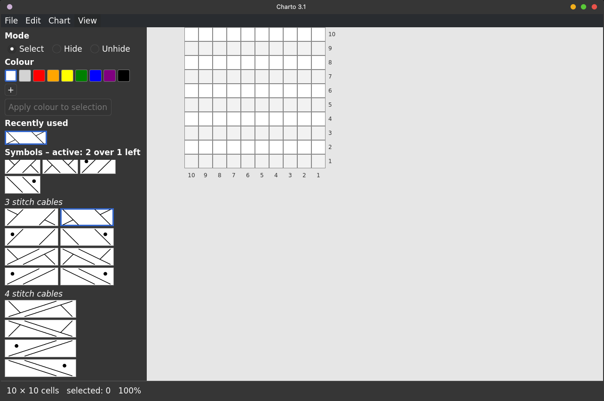

# Charto 3.1

Charto is a knitting-chart designer written in Rust with Qt 6. It is a port of
[sconcho](https://github.com/craftoid/sconcho), the knitting-chart designer by Markus Dittrich
(© 2009–2012, GPL-3.0), and reads and writes sconcho's `.spf` pattern files. Charto is a derivative
work and is therefore licensed GPL-3.0-or-later (see `COPYING`). The 88 bundled symbols in
`assets/symbols` come from the original project (their `description` files keep sconcho's
`<sconcho>` XML format).

## Status

Version 3.1.0. The Qt-free core (file formats, chart editing, undo/redo) and the first Qt 6 app were
confirmed to build and run. **Everything added after that has not been compiled yet**: printing
(`pdf.rs`, `print.rs`) and the features marked *new* below. Expect a few compile errors on the next
`cargo build`; the Qt-free parts have unit tests (`cargo test -p charto-core`).

### `charto-core` (Qt-free)

| Original feature | Rust |
|---|---|
| spf project files, API 1, 2, 3 | `spf.rs`, `qdatastream.rs` |
| symbol library | `symbols.rs` |
| grid, selection, painting, colouring, hide/unhide, copy/paste, insert/delete rows and columns, row repeats | `chart.rs` |
| unlimited undo/redo of every action | `document.rs` |
| tools, files, preferences, unsaved-changes tracking, recent files, crash recovery, JSON for the GUI | `session.rs` |
| row/column numbering and label modes, row highlighting | `labels.rs` |
| per-user files (XDG base directories), recent files list | `config.rs` |
| vector export as SVG | `svg.rs` |
| print-ready PDF (PNG in, one-page PDF out, fit to paper) | `pdf.rs` |

### `charto-app` (Qt 6 + QML, via `cxx-qt` 0.10)

Working in this first GUI version: open/save `.spf` (any API version, saved as API 3), new
pattern, symbol palette grouped by category with tooltips, active symbol (click a symbol, click
cells; multi-cell symbols such as cables need that many cells selected), colour list and custom
colours, apply colour to selection, click / rubber-band / row-label / column-label selection,
select / hide / unhide modes, undo/redo, copy, paste (into selection or "paste here" via right
click), insert/delete rows and columns, row repeats with their multiplier, row and column
numbering (rows from the bottom, columns from the right, label modes and left/right placement from
the project settings), zoom (Ctrl+wheel or View menu).

**Printing** (File > Print…, Ctrl+P): the whole chart is rendered from the window (selection marks
hidden) and sent through the freedesktop **Print portal** (`org.freedesktop.portal.Print`), so you get
your desktop's own print dialog (GTK or KDE) with its printers, copies, paper size and so on; the
chart is fitted onto one page of the chosen paper, in landscape or portrait to match the chart. This
needs `xdg-desktop-portal` plus a backend that implements printing (`xdg-desktop-portal-gtk` or
`xdg-desktop-portal-kde`). Without a print portal the PDF is opened with `xdg-open` in your default
viewer instead. Menu entries use the standard icon names of the freedesktop Icon Naming Specification
(`document-print`, `document-open`, ...). The page is a high-resolution raster image (about 300 dpi on
A4); multi-page tiling of very large charts and a vector PDF are not implemented.

**Languages**: the interface is available in German, Spanish, French, Hindi, Italian, Japanese, Portuguese
(Brazilian), Russian and Simplified Chinese; the texts are in `crates/charto-app/po/` as gettext `.po` files
and are built into the program, so nothing needs installing. Charto picks the language from `LANGUAGE`,
`LC_ALL`, `LC_MESSAGES` or `LANG`; to try another one, start it with `CHARTO_LANG=de charto` (`CHARTO_LANG=en`
gives English). The translations were written by Claude and have not been checked by native speakers.
To add a language, copy `po/charto.pot` to `po/<code>.po`, translate it, and list it in `src/translations.rs`
and in the test in `charto-core/src/i18n.rs`. After changing a text in the interface, run
`python3 crates/charto-app/po/update-pot.py` and update the `.po` files. The symbol palette headings, the names of the symbols and their hover descriptions are translated too
(`update-pot.py` reads `assets/symbols/*/description`). Not translated: symbols you add yourself, the buttons of
Qt's own dialogs (OK, Cancel, ...) and error messages that come from the pattern engine.

**Shortcuts**: the keyboard shortcuts (Ctrl+O, Ctrl+S, Ctrl+Z, ...) are defined as separate `Shortcut` items in `main.qml`, not on the menu actions, so the menus show no shortcut text.

**File dialogs** (Open, Save As, Export as PNG / SVG): these use the freedesktop **FileChooser portal**
(`org.freedesktop.portal.FileChooser`), so you get your desktop's own file dialog (Dolphin-style on KDE,
GTK on GNOME) with its places, bookmarks and remembered folders. This needs `xdg-desktop-portal` plus a
backend (`xdg-desktop-portal-kde` or `xdg-desktop-portal-gtk`). If the portal is not available, Charto
falls back to Qt's own dialog; start `charto` from a terminal to see why. The code is in
`crates/charto-app/src/filedialog.rs`, the URI helpers in `crates/charto-core/src/fileuri.rs`.

**Installing for your user** (desktop entry, `.spf` file type, icon, symbol library):
`cargo build -p charto-app --release`, then `packaging/install-user.sh`.

**Debian / Ubuntu package**: `packaging/build-deb.sh` builds the release binary and writes
`dist/charto.deb` (needs `dpkg-dev`; the maintainer line reads "Claude and Fibrely Designs", override it with `DEBFULLNAME` and `DEBEMAIL`). Install it with `sudo apt install ./dist/charto.deb`; remove it with
`sudo apt remove charto`. The package installs the program, the symbol library, the desktop entry,
the icon and the `.spf` file type system-wide and depends on the Qt 6 QML modules listed above.

A `.deb` is tied to the exact Qt it was built against (the QML compiler leaves two private Qt calls in the
binary), so a package built on one Ubuntu release will not install on another. To build one package per
release, each inside a clean container of that release, run `packaging/build-deb-in-container.sh`
(default releases 24.04, 25.10 and 26.04; needs podman or docker). Packages are written to
`dist/ubuntu-<release>/charto.deb`. Ubuntu 24.04 ships Qt 6.4, older than anything Charto has
been tested with (6.10.2), so that build may fail.

**RPM (Fedora)**: `packaging/build-rpm.sh` on Fedora, or `packaging/build-rpm-in-container.sh` from any
system with podman or docker (it builds inside a Fedora container). The spec is `packaging/charto.spec`;
the Rust crates are vendored with `cargo vendor`, so `rpmbuild` itself needs no network. The result is
`dist/charto-<version>-1.<dist>.<arch>.rpm`. openSUSE is not covered: its Qt 6 package names differ.

**Flatpak**: `packaging/flatpak/build-flatpak.sh` (add `--bundle` for a single `dist/charto.flatpak`
file). It builds against the KDE 6.10 runtime without network access: `cargo-sources.json` lists every
Rust crate from `Cargo.lock` and is regenerated by `packaging/flatpak/generate-cargo-sources.py`. The
sandbox gets no filesystem access; Open/Save/Print go through the portals. The application id
`org.charto.Charto` is a placeholder and must be changed before publishing on Flathub (it has to belong to
a domain or code-hosting account you control, and Flathub also wants screenshots in the metainfo file).

**New in this round**

- *Preferences* (Edit > Preferences…): cell size, row label mode (all / every n-th / odd / even),
  number of the bottom row, left/right placement of odd and even row labels, column label mode and
  interval, editable labels, row highlighting (on/off, odd or even rows, strength, colour), label and
  legend fonts. Settings apply to the open pattern and are remembered for new patterns.
- *Row highlighting*: every other row is tinted, as in the original (also in print and export).
- *Label editing*: with editable labels switched on, double-click a row or column label to type your
  own text (undoable; empty text brings the number back).
- *Select all with this colour / symbol* (right-click a cell).
- *Recently used symbols*: a quick-access row above the palette (cleared by new/open, like the
  original).
- *Export* (File menu): PNG image (what is on screen, at high resolution) and SVG drawing (vector;
  each symbol is embedded once, hidden cells are left out).
- *Recent files* (File > Open Recent): newest first, 10 entries, kept in
  `$XDG_CONFIG_HOME/charto/recent-files.txt`. (The original keeps the oldest entries and drops new
  ones when the list is full; Charto does the obvious thing.)
- *Unsaved changes*: the title shows `*`, and New, Open and Quit ask before discarding. Selecting cells
  does not count as a change.
- *Crash recovery*: every two minutes a recovery copy of a modified, saved pattern is written to
  `$XDG_STATE_HOME/charto/recovery/`; opening that pattern after a crash offers the recovered
  version. The copy is removed when you save or quit normally. (Patterns that were never saved have no
  file name and are not recovered, as in the original.)

**Still to do in the GUI:** legend, pattern repeat boxes, free text items and the custom symbol
manager (add/edit/delete symbols, zip import/export). They share the same groundwork (movable objects
on the chart whose positions are stored in the file), so they come together. A saved file keeps the
legend, pattern repeats and text items it was loaded with, but they are neither shown nor updated yet.

Deviations from the original are listed in `chart.rs`.

## Build and run

Needs Rust (stable), a C++17 compiler, Qt 6 development files and, at run time, the Qt Quick
Controls, Dialogs, Layouts and SVG modules (the symbols are SVG files). Tested target: Qt 6.10.2.

```
cargo test -p charto-core              # no Qt needed
cargo run -p charto-app --release      # the application; the binary is target/release/charto
```

`cxx-qt` finds Qt through `qmake`. If it picks the wrong Qt or none, point it at yours:

```
QMAKE=/path/to/qmake6 cargo run -p charto-app --release
```

On Debian/Ubuntu the run-time QML modules are `qml6-module-qtquick`, `qml6-module-qtquick-controls`,
`qml6-module-qtquick-dialogs`, `qml6-module-qtquick-layouts`, `qml6-module-qtquick-templates`,
`qml6-module-qtquick-window`, `qml6-module-qtqml` (the Open Recent menu) and `libqt6svg6`.

The program looks for symbols in `assets/symbols` of the source tree, next to the executable, in
`$CHARTO_SYMBOLS`, in `~/.charto/symbols` and in `~/.sconcho/symbols` (the original sconcho's folder for
own symbols, so symbols made there keep working). Later entries override earlier ones.
